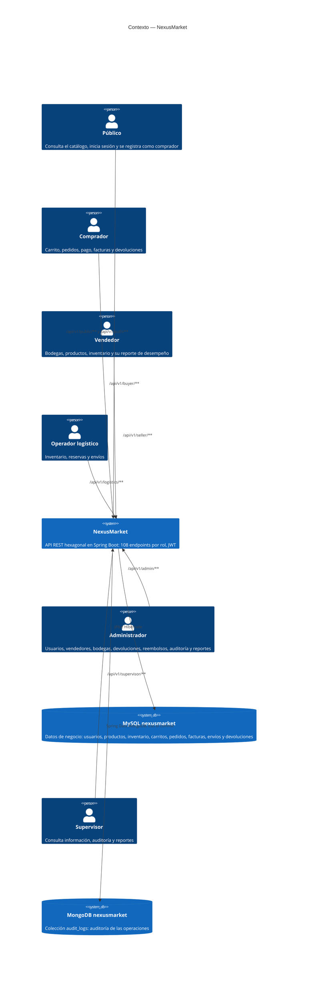

# C4 Nivel 1 — Contexto

## Propósito

Delimitar qué es NexusMarket, quién lo usa y con qué se relaciona. Toda la lógica del marketplace vive dentro del sistema. Fuera solo están los actores, que usan la API REST, y las dos bases de datos. El sistema no incluye interfaz gráfica, y la pasarela de pago es un adaptador simulado interno, no un sistema externo.

## Diagrama

## Actores

| Actor | Prefijo | Autenticación | Operaciones |
| --- | --- | --- | --- |
| Público | `/api/v1/public`, `/api/v1/auth` | No para catálogo, login y registro de compradores. Logout con JWT | Catálogo, login, logout y registro de compradores |
| Comprador | `/api/v1/buyer` | `BUYER` | Cuenta y perfil, carrito, pedidos, pago, factura, devolución y reembolso |
| Vendedor | `/api/v1/seller` | `SELLER` | Cuenta y perfil, bodegas, productos y su ciclo de vida, stock, pedidos con sus productos y reporte de desempeño |
| Operador logístico | `/api/v1/logistics` | `LOGISTICS_OPERATOR` | Bodegas, stock, ajustes, reservas, pedidos, envíos y reporte de inventario |
| Administrador | `/api/v1/admin` | `ADMINISTRATOR` | Usuarios internos, estado de usuarios, vendedores, compradores, bodegas del marketplace, facturas, devoluciones, reembolsos, auditoría y reportes |
| Supervisor | `/api/v1/supervisor` | `SUPERVISOR` | Consultas de usuarios, inventario, pedidos, facturas, devoluciones, auditoría y reportes. Lo único que modifica es su propia contraseña |

Detalle método por método: [11-endpoints-flujos.md](11-endpoints-flujos.md).

## Reglas de acceso

| Regla | Contenido | Dónde se aplica |
| --- | --- | --- |
| RG-01 | Toda operación la ejecuta un usuario autenticado y `ACTIVE` | `JwtAuthenticationFilter` y `ValidateUserStatusService` |
| RG-02 | Cada usuario tiene un solo rol | `User` y `ValidateRoleAuthorizationService` |
| RG-03 | Cada usuario solo accede a la información que le corresponde | `SecurityConfig`, `ValidateRoleAuthorizationService`, `ValidateBuyerOwnershipService` y `ValidateSellerOwnershipService` |
