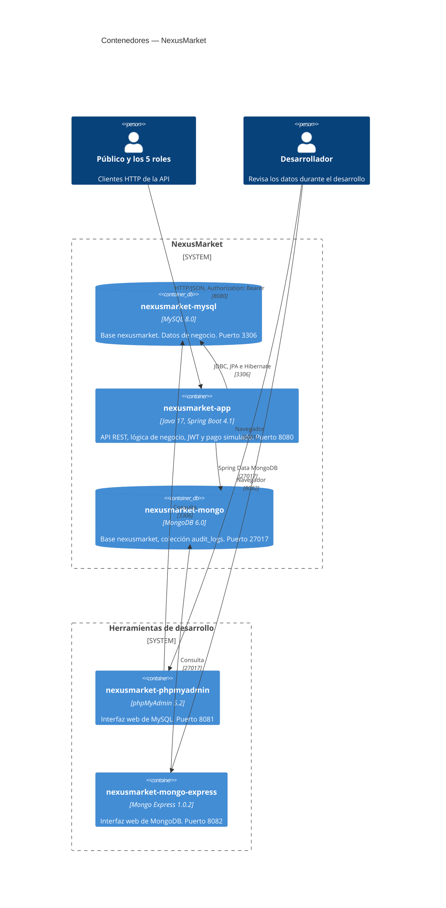
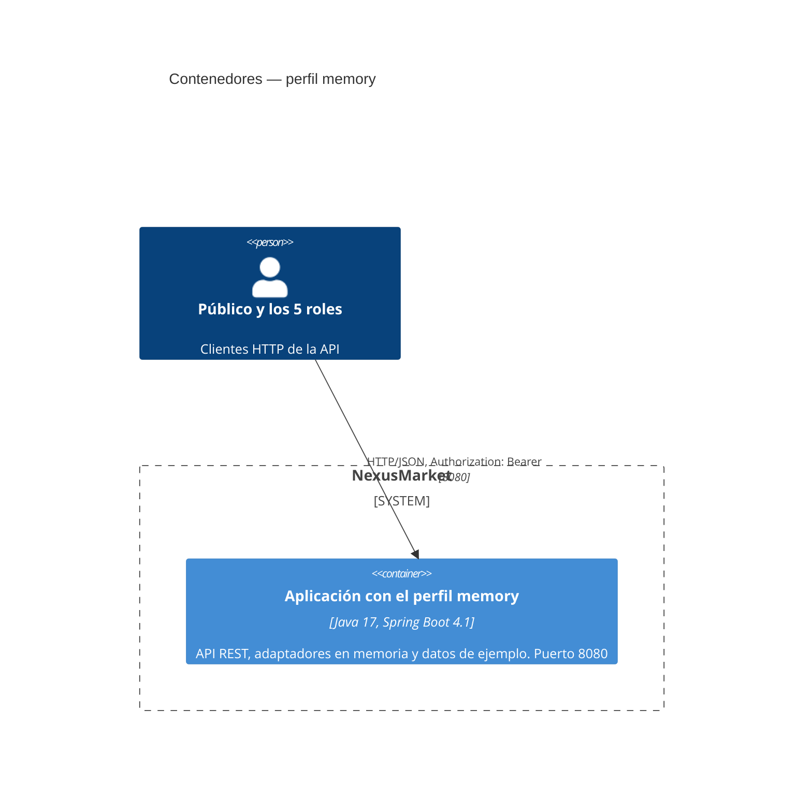

# C4 Nivel 2 — Contenedores

## Propósito

Mostrar las piezas que se ejecutan por separado y cómo se conectan. Todas las define `docker-compose.yml`. El desarrollador aparece solo en este nivel, porque es quien usa las herramientas de desarrollo.

## Diagrama

## Contenedores

| Servicio | Contenedor | Imagen | Puerto | Healthcheck | Espera a |
| --- | --- | --- | --- | --- | --- |
| `mysql-db` | `nexusmarket-mysql` | `mysql:8.0` | 3306 | `mysqladmin ping` por TCP | — |
| `mongo-db` | `nexusmarket-mongo` | `mongo:6.0` | 27017 | `mongosh` con `ping` | — |
| `nexusmarket-app` | `nexusmarket-app` | `application/Dockerfile` | 8080 | `curl` a `/actuator/health` | `mysql-db` y `mongo-db` sanos |
| `phpmyadmin` | `nexusmarket-phpmyadmin` | `phpmyadmin:5.2` | 8081 | — | `mysql-db` sano |
| `mongo-express` | `nexusmarket-mongo-express` | `mongo-express:1.0.2` | 8082 | — | `mongo-db` iniciado |

phpMyAdmin y Mongo Express son herramientas de desarrollo. La aplicación no depende de ellas.

## Perfil `memory`: un solo proceso

Con `mvnw.cmd spring-boot:run -Dspring-boot.run.profiles=memory`, la aplicación es el único proceso: no hay contenedores ni bases de datos, y los datos viven en la memoria de la JVM. Es para demostraciones y pruebas; los datos se pierden al detenerla. Ver [la capa de persistencia](07-capa-adapters-persistence.md#perfil-memory).

## Imagen de la aplicación

`application/Dockerfile` tiene dos etapas: Maven con JDK 17 compila el jar sin ejecutar pruebas, y la imagen final solo trae el JRE 17 y el jar, con un usuario sin privilegios de root. Arranca con `-Duser.timezone=America/Bogota`.

## Datos

| Almacén | Volumen | Qué guarda | Consistencia |
| --- | --- | --- | --- |
| MySQL `nexusmarket` | `mysql_data` | Todo el estado de negocio | Transacción de cada caso de uso, con `@Version` para el bloqueo optimista |
| MongoDB `nexusmarket` | `mongo_data` | La colección `audit_logs` | Se escribe tras el commit de MySQL, en `afterCommit` |
| `nexusmarket_test`, en ambos | Los mismos | Datos de las pruebas de integración | Bases separadas, con el perfil `test` |

## Variables de entorno de la aplicación

| Variable | Uso |
| --- | --- |
| `TZ` | Zona horaria del contenedor, `America/Bogota` |
| `MYSQL_URL`, `MYSQL_USERNAME`, `MYSQL_PASSWORD` | Conexión a MySQL, con el host `mysql-db` |
| `MONGODB_URI` | Conexión a MongoDB, con el host `mongo-db` |
| `JWT_SECRET` | Clave de firma de los tokens |
| `SEED_ADMIN_EMAIL`, `SEED_ADMIN_PASSWORD` | Administrador inicial |

Fuera de Docker, la aplicación usa los valores de `application.yml`, con `localhost`, contra los mismos contenedores de bases de datos. Ver [SETUP.md](../../SETUP.md).
