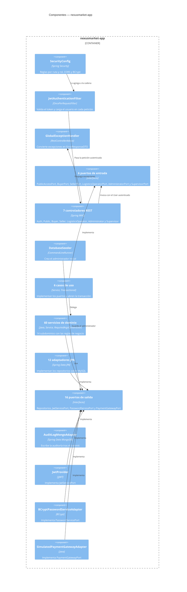
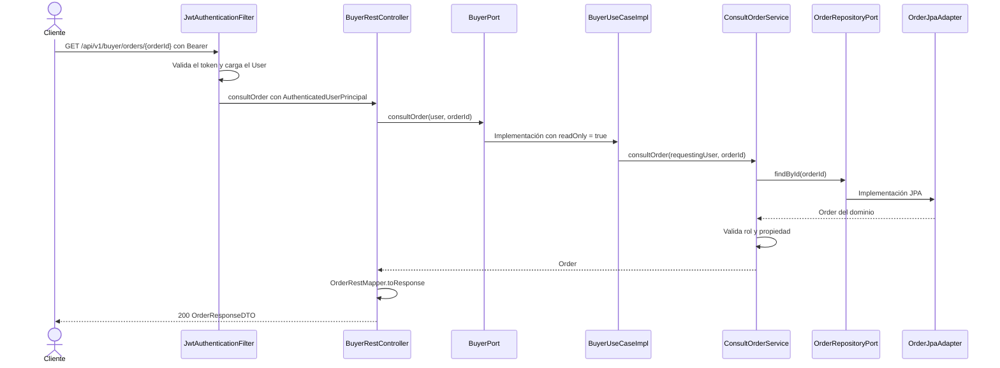

# C4 Nivel 3 — Componentes

## Propósito

Abrir `nexusmarket-app` y mostrar sus componentes: cadena de seguridad, controladores, puertos, casos de uso, servicios de dominio y adaptadores de salida.

## Diagrama

`JwtAuthenticationFilter` usa `JwtServicePort`, que está entre los puertos de salida. Los 12 adaptadores JPA llegan a MySQL `nexusmarket` y `AuditLogMongoAdapter` a la colección `audit_logs` de MongoDB, como muestra [el nivel 2](02-nivel-2-contenedores.md). Esas líneas se omiten aquí para que el diagrama se pueda leer.

## Ciclo de vida de una petición autenticada

## Componentes por paquete

| Componente | Paquete | Ficha |
| --- | --- | --- |
| Controladores, DTO, mappers, errores | `nexusmarket.adapters.rest` | [05](05-capa-adapters-rest.md) |
| Casos de uso | `nexusmarket.adapters.useCases` | [06](06-capa-adapters-usecases.md) |
| Adaptadores JPA y MongoDB | `nexusmarket.adapters.persistence` | [07](07-capa-adapters-persistence.md) |
| Pago simulado | `nexusmarket.adapters.payment` | [07](07-capa-adapters-persistence.md) |
| Seguridad | `nexusmarket.adapters.security` | [08](08-capa-adapters-security.md) |
| Dominio | `nexusmarket.domain` | [09](09-capa-domain.md) |
| Semilla | `nexusmarket.infrastructure.seed` | [10](10-capa-infrastructure.md) |
