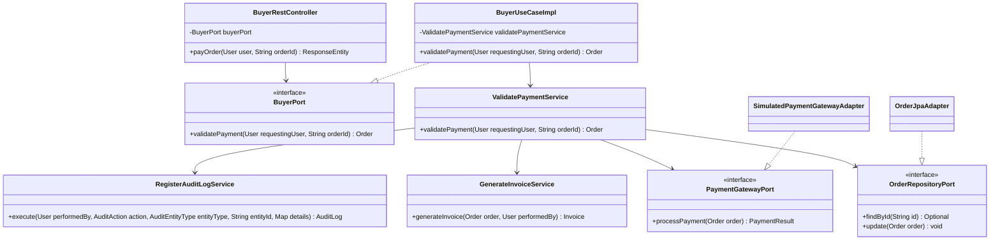
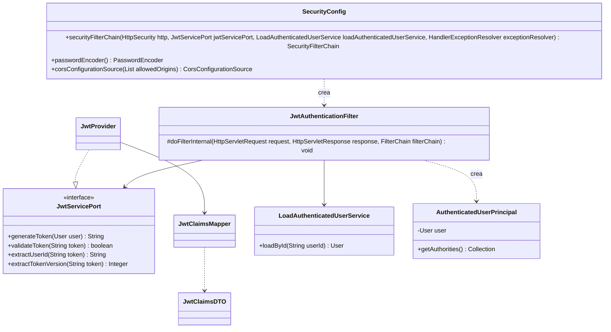
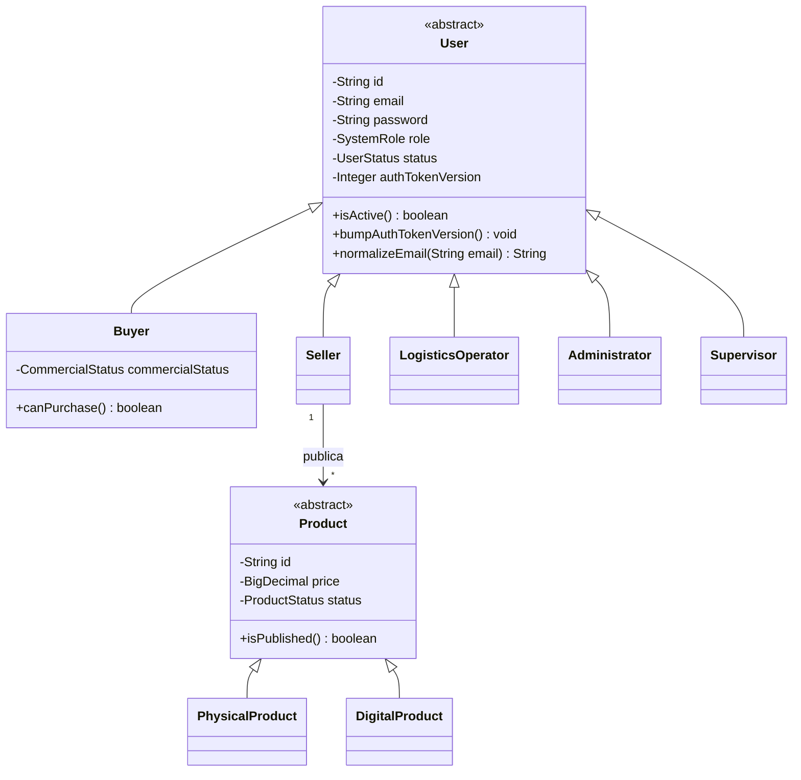
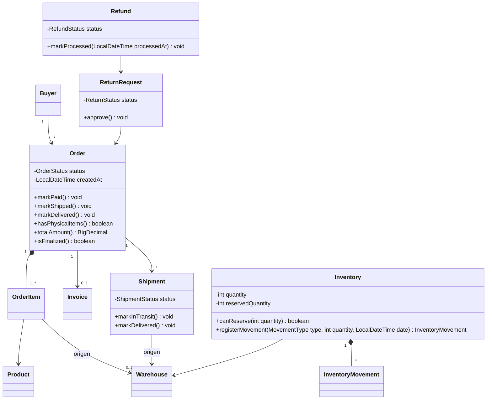

# C4 Nivel 4 — Código

## Propósito

Mostrar las clases que colaboran en cada recorrido, con sus nombres reales. Son diagramas simplificados: solo incluyen los miembros que explican el recorrido. El inventario completo está en las fichas de cada capa.

## Del controlador al adaptador: pagar un pedido

## Seguridad

## Jerarquía de usuarios y productos

## Relaciones del pedido

