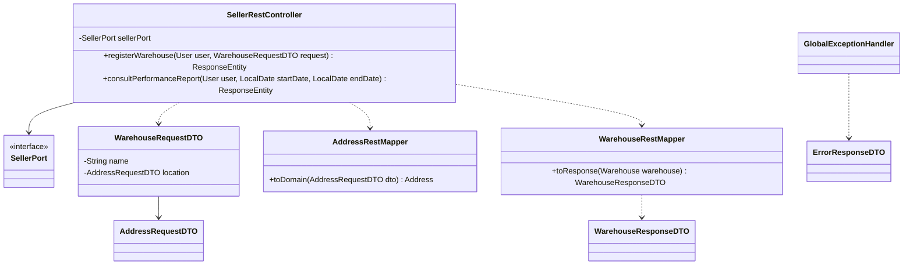
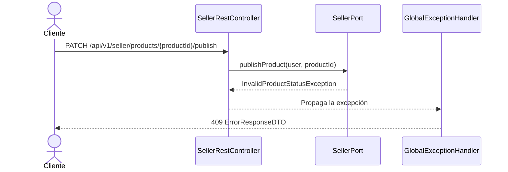

# Capa — Adaptador REST

Paquete: `nexusmarket.adapters.rest`. Traduce HTTP al dominio y no contiene reglas de negocio. Cada controlador inyecta solo su puerto por rol. Contrato detallado en [Rest-adapters.md](../Adapters/Rest-adapters.md).

## Controladores

| Controlador | Ruta base | Rol | Puerto | Endpoints |
| --- | --- | --- | --- | ---: |
| `AuthRestController` | `/api/v1/auth` | público o autenticado | `PublicAccessPort` | 3 |
| `PublicRestController` | `/api/v1/public` | público | `PublicAccessPort` | 2 |
| `BuyerRestController` | `/api/v1/buyer` | `BUYER` | `BuyerPort` | 17 |
| `SellerRestController` | `/api/v1/seller` | `SELLER` | `SellerPort` | 20 |
| `LogisticsOperatorRestController` | `/api/v1/logistics` | `LOGISTICS_OPERATOR` | `LogisticsOperatorPort` | 17 |
| `AdministratorRestController` | `/api/v1/admin` | `ADMINISTRATOR` | `AdministratorPort` | 27 |
| `SupervisorRestController` | `/api/v1/supervisor` | `SUPERVISOR` | `SupervisorPort` | 22 |

## Convenciones

- **Usuario autenticado:** los controladores lo reciben con `@AuthenticationPrincipal(expression = "user")` y lo pasan como primer argumento del puerto.
- **Rutas propias sin id:** en `/account`, `/profile`, `/cart` y las listas propias, el controlador pasa `user.getId()`. Un usuario no puede pedir el recurso de otro cambiando la URL, y los servicios validan además la propiedad.
- **Catálogos fijos:** `SellerRestController` registra bodegas con `WarehouseType.SELLER`, y `AdministratorRestController` con `WarehouseType.MARKETPLACE`.
- **Catálogos del cliente:** los códigos del cuerpo o de la ruta se convierten con `fromCode`, como `ProductType.fromCode` o `AuditEntityType.fromCode`. Un código desconocido responde 400.
- **Periodos:** `startDate` y `endDate` se convierten en `ReportPeriod`.

## DTO y mappers

| Tipo | Ubicación | Cantidad | Ejemplos |
| --- | --- | ---: | --- |
| Peticiones | `dtos/requests` | 20 | `LoginRequestDTO`, `RegisterSellerRequestDTO`, `AddCartItemRequestDTO` |
| Respuestas | `dtos/responses` | 27 | `OrderResponseDTO`, `InventoryReportResponseDTO`, `ErrorResponseDTO` |
| Mappers | `mappers` | 14 | `OrderRestMapper`, `ReportRestMapper`, `VariantRestMapper` |

Las respuestas nunca incluyen contraseñas, hashes ni versiones de token. Los DTO de petición declaran las validaciones de Jakarta, descritas en [Rest-validation.md](../Adapters/Rest-validation.md).

## Documentación del API

springdoc-openapi genera Swagger UI (`/swagger-ui.html`) y la especificación (`/v3/api-docs`) desde los controladores. Cada controlador declara `@Tag`, y cada operación `@Operation` y `@ApiErrors`. `OpenApiConfig`, en `adapters/rest/openapi`, aporta la información general, el esquema `bearerAuth`, las respuestas de error y la descripción de los parámetros.

## Errores

`GlobalExceptionHandler` convierte cada excepción en un `ErrorResponseDTO`, con `timestamp`, `status`, `error`, `message`, `path` y, solo en errores de validación, `errors`.

La tabla completa de excepciones y códigos está en [Global-exception-handler.md](../Adapters/Global-exception-handler.md).
