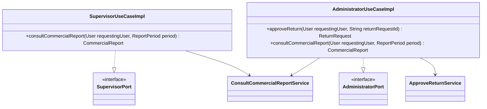
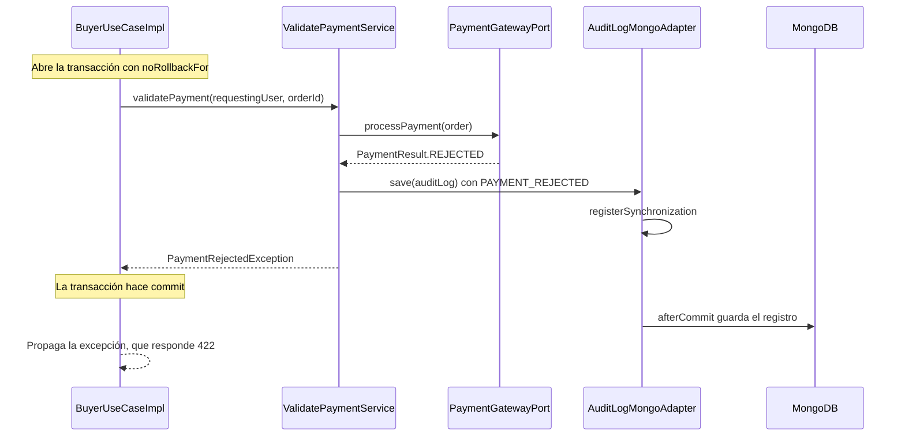

# Capa — Adaptadores de casos de uso

Paquete: `nexusmarket.adapters.useCases`. Implementan los 6 puertos de entrada inyectando servicios de dominio concretos. No deciden reglas: delegan en un servicio y fijan el **límite transaccional**. Contrato en [Use-cases-adapters.md](../Adapters/Use-cases-adapters.md).

## Matriz puerto → implementación

| Puerto | Implementación | Métodos | Solo lectura | Servicios inyectados |
| --- | --- | ---: | ---: | ---: |
| `PublicAccessPort` | `PublicAccessUseCaseImpl` | 5 | 2 | 4 |
| `BuyerPort` | `BuyerUseCaseImpl` | 17 | 8 | 16 |
| `SellerPort` | `SellerUseCaseImpl` | 20 | 9 | 18 |
| `LogisticsOperatorPort` | `LogisticsOperatorUseCaseImpl` | 17 | 7 | 15 |
| `AdministratorPort` | `AdministratorUseCaseImpl` | 27 | 16 | 23 |
| `SupervisorPort` | `SupervisorUseCaseImpl` | 22 | 21 | 17 |

El método de cada puerto y su servicio están en [la matriz del documento 11](11-endpoints-flujos.md).

## Transacciones

| Regla | Dónde | Efecto |
| --- | --- | --- |
| `@Transactional` | Clase | Toda operación corre en una transacción y se revierte ante una excepción |
| `@Transactional(readOnly = true)` | Métodos `consult*` | Las consultas no escriben |
| `@Transactional(noRollbackFor = PaymentRejectedException.class)` | `BuyerUseCaseImpl.validatePayment` | El pago rechazado no se revierte, así que la auditoría de `PAYMENT_REJECTED` sí se escribe |

Los servicios de dominio no conocen las transacciones, porque el dominio no depende de Spring.

## Secuencia — Transacción de un pago rechazado

## Verificación

`UseCaseTransactionalAnnotationsTest` comprueba estas anotaciones por reflexión, y `TransactionalConsistencyIT` comprueba su comportamiento con bases reales. Ver [Testing-strategy.md](../Testing/Testing-strategy.md).
