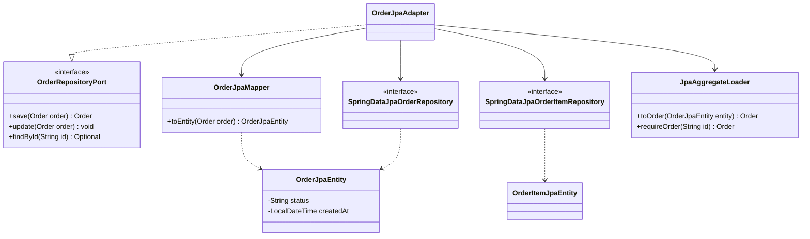
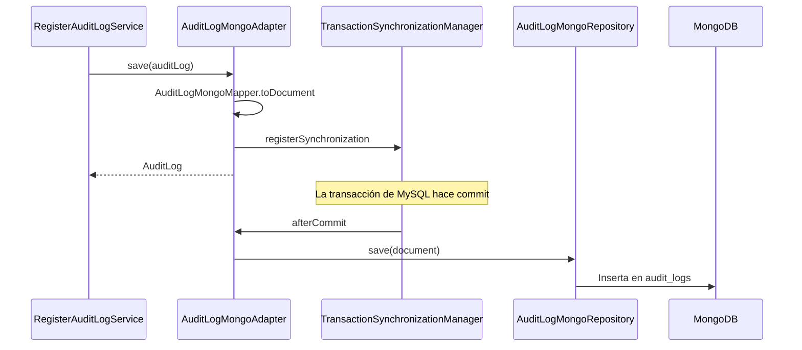

# Capa — Adaptadores de persistencia y pago

Paquetes: `nexusmarket.adapters.persistence` y `nexusmarket.adapters.payment`. Implementan los puertos de salida de datos y de pago. Contrato en [Persistence-adapters.md](../Adapters/Persistence-adapters.md).

## Matriz puerto → adaptador → almacenamiento

| Puerto | Adaptador | Entidad o documento | Tablas o colección |
| --- | --- | --- | --- |
| `UserRepositoryPort` | `UserJpaAdapter` | `UserJpaEntity` | `users` |
| `BuyerRepositoryPort` | `BuyerJpaAdapter` | `UserJpaEntity` | `users`, `buyer_additional_addresses` |
| `SellerRepositoryPort` | `SellerJpaAdapter` | `UserJpaEntity` | `users` |
| `WarehouseRepositoryPort` | `WarehouseJpaAdapter` | `WarehouseJpaEntity` | `warehouses` |
| `ProductRepositoryPort` | `ProductJpaAdapter` | `ProductJpaEntity` | `products`, `product_variants` |
| `InventoryRepositoryPort` | `InventoryJpaAdapter` | `InventoryJpaEntity`, `InventoryMovementJpaEntity` | `inventories`, `inventory_movements` |
| `CartRepositoryPort` | `CartJpaAdapter` | `CartJpaEntity`, `CartItemJpaEntity` | `carts`, `cart_items` |
| `OrderRepositoryPort` | `OrderJpaAdapter` | `OrderJpaEntity`, `OrderItemJpaEntity` | `orders`, `order_items` |
| `InvoiceRepositoryPort` | `InvoiceJpaAdapter` | `InvoiceJpaEntity` | `invoices` |
| `ShipmentRepositoryPort` | `ShipmentJpaAdapter` | `ShipmentJpaEntity` | `shipments` |
| `ReturnRequestRepositoryPort` | `ReturnRequestJpaAdapter` | `ReturnRequestJpaEntity` | `return_requests` |
| `RefundRepositoryPort` | `RefundJpaAdapter` | `RefundJpaEntity` | `refunds` |
| `AuditLogRepositoryPort` | `AuditLogMongoAdapter` | `AuditLogDocument` | `audit_logs` (MongoDB) |
| `PaymentGatewayPort` | `SimulatedPaymentGatewayAdapter` | — | — |

Los otros dos puertos de salida, `JwtServicePort` y `PasswordServicePort`, están en [la capa de seguridad](08-capa-adapters-security.md).

## Decisiones

- **Entidades planas:** las entidades JPA guardan identificadores, no asociaciones. `JpaAggregateLoader` reconstruye los objetos del dominio a partir de ellas.
- **Separación del dominio:** los mappers de `jpa/mappers` convierten entre entidad y modelo, así que el dominio no conoce JPA y las entidades no llegan a la API.
- **Bloqueo optimista:** `UserJpaEntity`, `CartJpaEntity`, `InventoryJpaEntity` y `OrderJpaEntity` tienen `@Version`. Un conflicto responde 409 y evita, por ejemplo, vender dos veces el mismo stock.
- **Esquema:** `ddl-auto: update` crea y actualiza las tablas al arrancar.
- **Fechas:** las columnas `DATETIME` guardan la hora de Colombia. Ver [10-capa-infrastructure.md](10-capa-infrastructure.md#zona-horaria).

## Auditoría tras el commit

La transacción de MySQL no cubre MongoDB. Por eso `AuditLogMongoAdapter` no escribe de inmediato cuando hay una transacción activa: registra una sincronización y guarda el documento en `afterCommit`. Si la transacción se revierte, no queda auditoría falsa. Si MongoDB falla tras el commit, la operación de negocio ya está confirmada y el adaptador registra el error con todos los datos del evento.

## Pago simulado

`SimulatedPaymentGatewayAdapter` aprueba cualquier pedido cuyo total no supere `app.payment.simulated.approval-limit`, y rechaza los demás. Así se puede probar el camino de rechazo sin una pasarela real.
