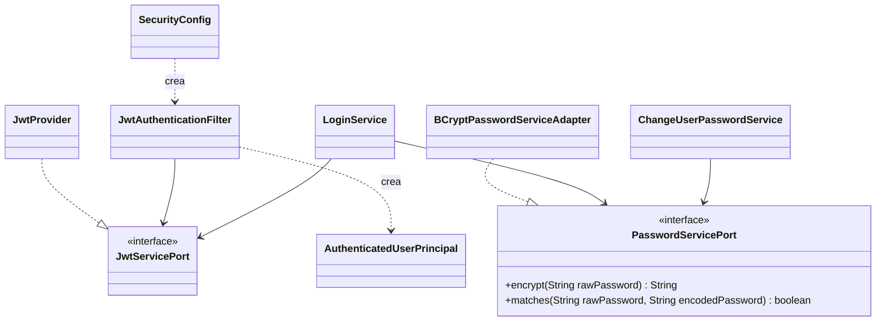
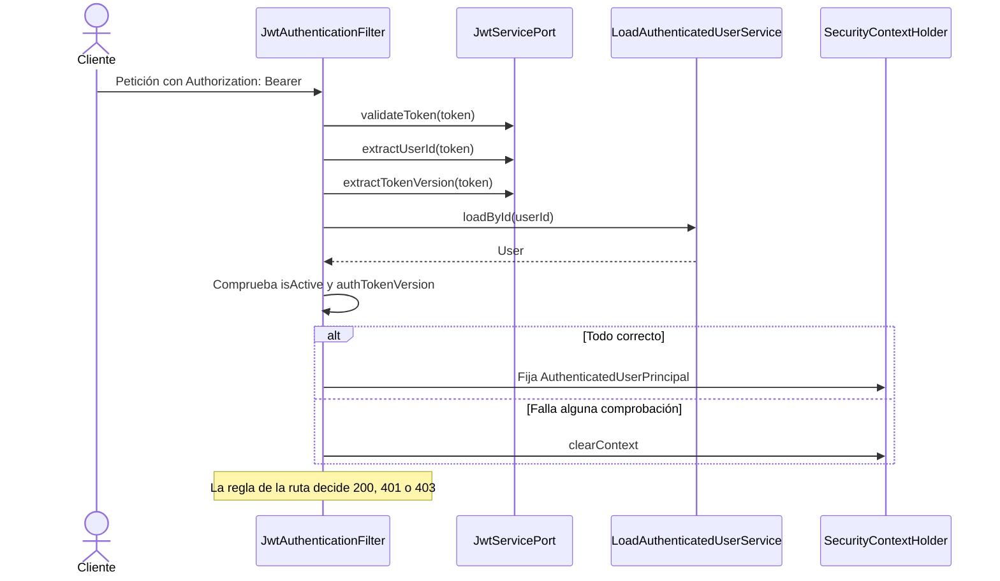

# Capa — Adaptador de seguridad

Paquete: `nexusmarket.adapters.security`. Contiene la cadena de seguridad, los tokens y las contraseñas. Contrato en [Security-adapters.md](../Adapters/Security-adapters.md) y [Rest-security-cors.md](../Adapters/Rest-security-cors.md).

## Clases

| Clase | Responsabilidad |
| --- | --- |
| `SecurityConfig` | Cadena de filtros sin estado, reglas por ruta, CORS y el `PasswordEncoder` |
| `JwtAuthenticationFilter` | Valida el token de cada petición y fija el usuario autenticado |
| `JwtProvider` | Implementa `JwtServicePort` con JJWT y HS256 |
| `JwtClaimsMapper`, `JwtClaimsDTO` | Convierten entre `User` y los claims del token |
| `BCryptPasswordServiceAdapter` | Implementa `PasswordServicePort` con BCrypt |
| `AuthenticatedUserPrincipal` | Envuelve al `User` del dominio para Spring Security |

## Reglas por ruta

| Ruta | Regla |
| --- | --- |
| `POST /api/v1/auth/login` | abierta |
| `POST /api/v1/auth/register/**` | abierta |
| `GET /api/v1/public/**` | abierta |
| `GET /actuator/health` | abierta; ningún otro endpoint del actuator está expuesto |
| `OPTIONS /**` | abierta, para CORS |
| `/api/v1/auth/logout` | autenticada, cualquier rol |
| `/api/v1/buyer/**` | `hasRole("BUYER")` |
| `/api/v1/seller/**` | `hasRole("SELLER")` |
| `/api/v1/logistics/**` | `hasRole("LOGISTICS_OPERATOR")` |
| `/api/v1/admin/**` | `hasRole("ADMINISTRATOR")` |
| `/api/v1/supervisor/**` | `hasRole("SUPERVISOR")` |
| cualquier otra | autenticada |

Sin token o con un token inválido, la respuesta es 401. Con un rol que no corresponde, 403. Ambas usan el mismo `ErrorResponseDTO`, porque `SecurityConfig` delega en el `HandlerExceptionResolver` y este en `GlobalExceptionHandler`.

## Token

| Claim | Contenido |
| --- | --- |
| `sub` | Id del usuario |
| `jti` | Id del token |
| `ver` | `authTokenVersion` del usuario al emitirlo |
| `iat`, `exp` | Emisión y vencimiento |

El token no contiene datos personales ni el rol: el filtro carga el usuario desde la base en cada petición, y así un cambio de estado o de rol se aplica de inmediato.

## Validación de cada petición

## Invalidación de tokens

`LogoutService`, `ChangeUserPasswordService` y `ChangeUserStatusService` cambian `authTokenVersion`. Los tokens anteriores dejan de coincidir y responden 401, aunque su firma y su vencimiento sean válidos. La secuencia está en [11-endpoints-flujos.md](11-endpoints-flujos.md#7-logout-e-invalidación-del-token).
