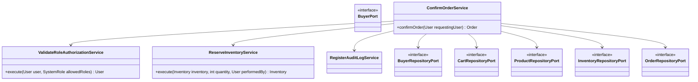
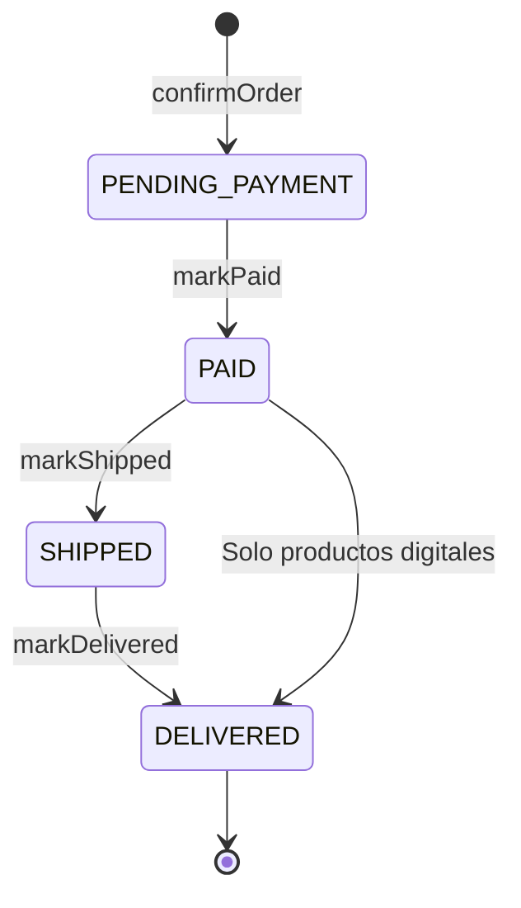

# Capa — Dominio

Paquete: `nexusmarket.domain`. Contiene toda la lógica de negocio, sin dependencias de JPA, MongoDB, HTTP, JSON, JWT ni Spring Security. Sus únicas anotaciones de framework son `@Service` y `@RequiredArgsConstructor` en los servicios, para la inyección de dependencias; los modelos, objetos de valor, excepciones y puertos no usan ninguna. Se prueba sin arrancar Spring y sin infraestructura. Especificación en [Domain Model](../domain/Domain%20Model.md), [Domain Value Objects](../domain/Domain%20Value%20Objects.md) y [Domain Services](../domain/Domain%20Services.md).

## Estructura

| Paquete | Contenido | Cantidad |
| --- | --- | ---: |
| `models` | Entidades, resultado de autenticación y reportes de solo lectura | 28 |
| `valueobjects` | Catálogos, `Address`, `Variant`, `ReportPeriod` y la interfaz `DomainCatalog` | 19 |
| `exceptions` | `DomainException` y sus subclases | 27 |
| `services` | Servicios por subdominio | 60 |
| `ports/in` | Un puerto por rol | 6 |
| `ports/out` | Repositorios y servicios técnicos | 16 |

## Modelos

| Grupo | Clases |
| --- | --- |
| Usuarios | `User`, `Buyer`, `Seller`, `LogisticsOperator`, `Administrator`, `Supervisor`, `AuthenticationResult` |
| Catálogo | `Product`, `PhysicalProduct`, `DigitalProduct` |
| Inventario | `Warehouse`, `Inventory`, `InventoryMovement` |
| Compra | `Cart`, `CartItem`, `Order`, `OrderItem`, `Invoice` |
| Logística y devoluciones | `Shipment`, `ReturnRequest`, `Refund` |
| Auditoría | `AuditLog` |
| Reportes | `CommercialReport`, `SellerPerformanceReport`, `InventoryReport`, `WarehouseStockSummary`, `LowStockProduct`, `LogisticsReport` |

Las relaciones están en [04-nivel-4-codigo.md](04-nivel-4-codigo.md).

## Servicios por subdominio

| Subdominio | Servicios |
| --- | --- |
| `user` | `RegisterBuyerUserService`, `RegisterStaffUserService`, `LoginService`, `LogoutService`, `LoadAuthenticatedUserService`, `ConsultUserService`, `ChangeUserStatusService`, `ChangeUserPasswordService` |
| `seller` | `RegisterSellerService`, `ConsultSellerService`, `UpdateSellerService` |
| `buyer` | `ConsultBuyerService`, `UpdateBuyerProfileService`, `ChangeBuyerCommercialStatusService` |
| `warehouse` | `RegisterWarehouseService`, `ConsultWarehouseService`, `UpdateWarehouseService` |
| `product` | `RegisterProductService`, `UpdateProductService`, `PublishProductService`, `SuspendProductService`, `DiscontinueProductService`, `ConsultCatalogService`, `ConsultSellerProductsService` |
| `inventory` | `RegisterInitialStockService`, `RegisterInventoryInboundService`, `RegisterInventoryAdjustmentService`, `ReserveInventoryService`, `ReleaseInventoryReservationService`, `ConsultInventoryService` |
| `cart` | `AddItemToCartService`, `RemoveItemFromCartService`, `UpdateCartItemQuantityService`, `ConsultCartService`, `ClearCartService` |
| `order` | `ConfirmOrderService`, `ValidatePaymentService`, `ConsultOrderService`, `ConsultBuyerOrdersService` |
| `invoice` | `GenerateInvoiceService`, `ConsultInvoiceService` |
| `shipment` | `CreateShipmentsService`, `PackShipmentService`, `DispatchShipmentService`, `ConfirmDeliveryService` |
| `returns` | `RequestReturnService`, `ApproveReturnService`, `RejectReturnService`, `ProcessRefundService`, `ConsultReturnService` |
| `authorization` | `ValidateUserStatusService`, `ValidateRoleAuthorizationService`, `ValidateBuyerOwnershipService`, `ValidateSellerOwnershipService` |
| `audit` | `RegisterAuditLogService`, `ConsultAuditLogsService` |
| `reporting` | `ConsultCommercialReportService`, `ConsultSellerPerformanceReportService`, `ConsultInventoryReportService`, `ConsultLogisticsReportService` |

## Puertos

`BuyerPort` no se relaciona directamente con los servicios: lo implementa `BuyerUseCaseImpl`, en la [capa de casos de uso](06-capa-adapters-usecases.md). Las listas completas están en [Input-ports.md](../domain/Input-ports.md) y [Output-ports.md](../domain/Output-ports.md).

## Estados

**Pedido** (`OrderStatus`). Un pedido nace en `PENDING_PAYMENT`. Si solo tiene productos digitales, pasa de `PAID` a `DELIVERED` al pagar.

**Envío** (`ShipmentStatus`): `PREPARING`, `PACKED`, `IN_TRANSIT` y `DELIVERED`.

**Producto** (`ProductStatus`): `DRAFT`, `PUBLISHED`, `SUSPENDED` y `DISCONTINUED`.

**Devolución** (`ReturnStatus`): `REQUESTED`, y luego `APPROVED` o `REJECTED`.

**Reembolso** (`RefundStatus`): `PENDING`, y luego `PROCESSED`.

## Efecto en el inventario

Cada cambio de stock es un `InventoryMovement` de un `MovementType`. En una compra de 2 unidades con un stock inicial de 10:

| Momento | Movimiento | Disponible | Reservado |
| --- | --- | ---: | ---: |
| Stock inicial | `INBOUND` | 10 | 0 |
| Confirmar pedido | `RESERVATION` | 8 | 2 |
| Despachar envío | `SALE_OUTBOUND` | 8 | 0 |
| Aprobar devolución | `RETURN` | 10 | 0 |

## Excepciones

Las 27 excepciones extienden `DomainException`, y `GlobalExceptionHandler` les asigna el código HTTP. La tabla completa está en [Global-exception-handler.md](../Adapters/Global-exception-handler.md).
