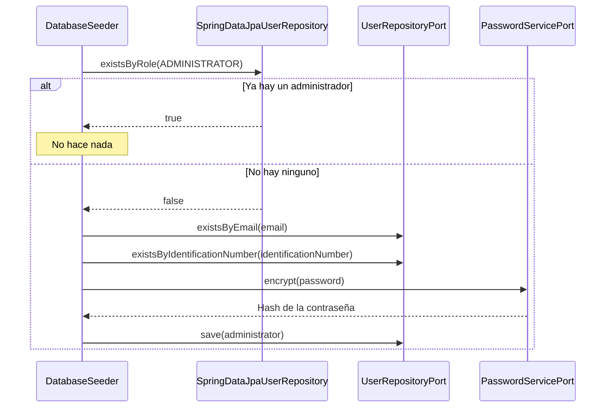
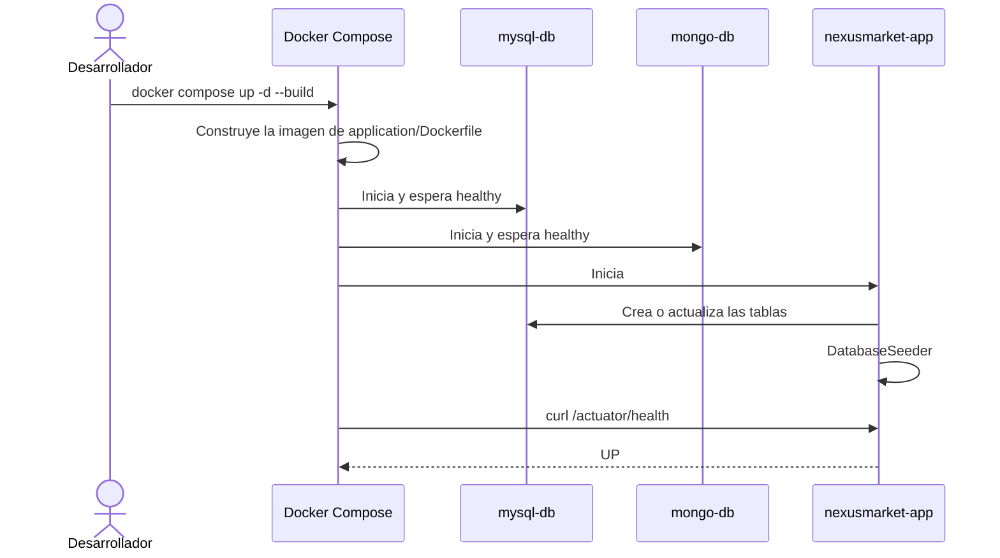

# Capa — Infraestructura

Paquete: `nexusmarket.infrastructure`. Contiene componentes técnicos sin lógica de negocio. Esta ficha también reúne el arranque, la configuración y el despliegue.

## Arranque

`App` es la clase principal. Excluye `UserDetailsServiceAutoConfiguration`, porque la autenticación es solo por JWT y el usuario en memoria de Spring Boot no debe existir.

## Administrador inicial

`DatabaseSeeder` es un `CommandLineRunner` que se ejecuta al terminar el arranque.

Por eso, `SEED_ADMIN_EMAIL` y `SEED_ADMIN_PASSWORD` solo se aplican con la base sin administradores. Si el correo o el documento ya los usa otro usuario, registra una advertencia y no lo crea.

## Configuración

`application/src/main/resources/application.yml` concentra la configuración. El detalle está en [Software Architecture](../Software%20Architecture/Software%20Architecture.md#configuration-and-local-environment).

| Prefijo | Contenido |
| --- | --- |
| `spring.datasource` | Conexión a MySQL |
| `spring.jpa` | Esquema automático y zona horaria de Hibernate |
| `spring.mongodb.uri` | Conexión a MongoDB |
| `management` | Expone solo `/actuator/health`, sin detalles |
| `app.security.jwt` | Clave y vencimiento del token |
| `app.security.cors` | Orígenes permitidos |
| `app.payment.simulated` | Límite de aprobación del pago simulado |
| `app.seed.admin` | Datos del administrador inicial |

## Salud

`GET /actuator/health` responde `UP` con 200 solo si MySQL y MongoDB responden, y `DOWN` con 503 si falla alguna. Lo usa el healthcheck de `nexusmarket-app`.

## Zona horaria

La aplicación usa siempre `America/Bogota`, y por eso los reportes pueden usar la fecha de hoy.

| Dónde | Configuración |
| --- | --- |
| JVM en Docker | `-Duser.timezone=America/Bogota` en el `ENTRYPOINT`, y `TZ` en `docker-compose.yml` |
| JVM fuera de Docker | `spring-boot-maven-plugin` en `pom.xml` |
| Pruebas | `argLine` de `maven-surefire-plugin` y `maven-failsafe-plugin` |
| MySQL | `serverTimezone` en la URL y `hibernate.jdbc.time_zone` |

MySQL guarda la hora de Colombia. MongoDB guarda instantes en UTC, así que Mongo Express muestra 5 horas más, aunque la API devuelve la hora de Colombia.

## Despliegue

Los pasos completos están en [SETUP.md](../../SETUP.md).
