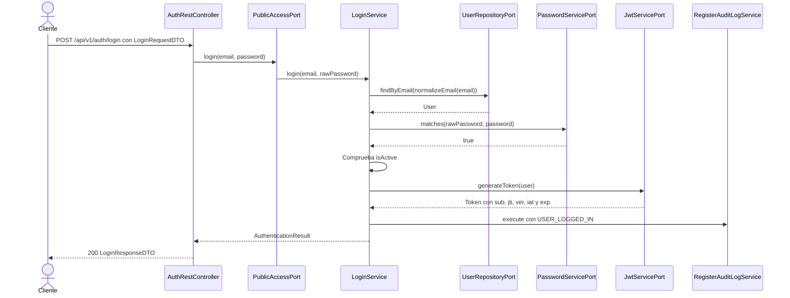
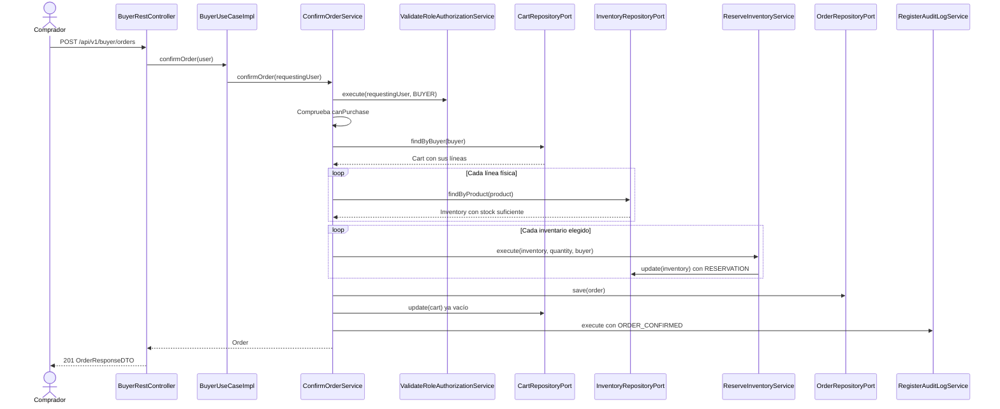
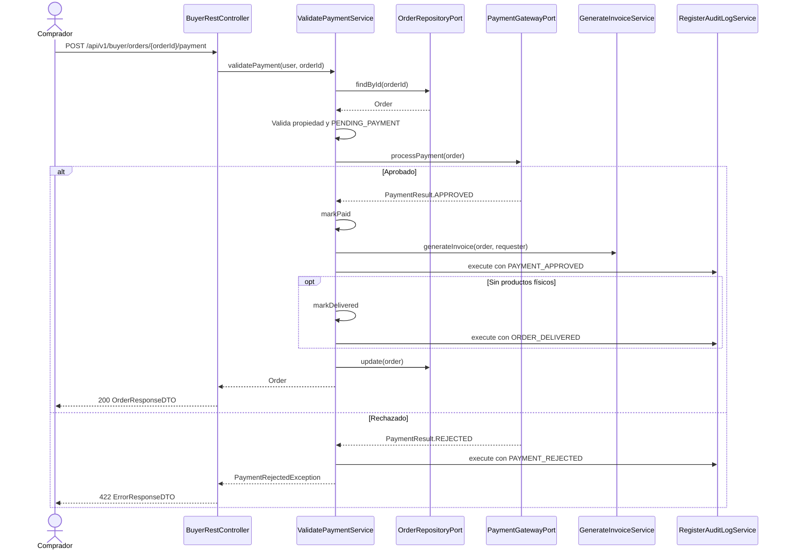
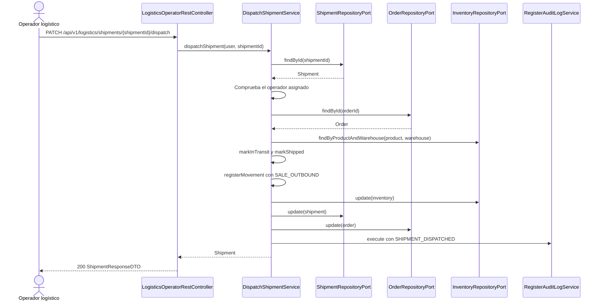
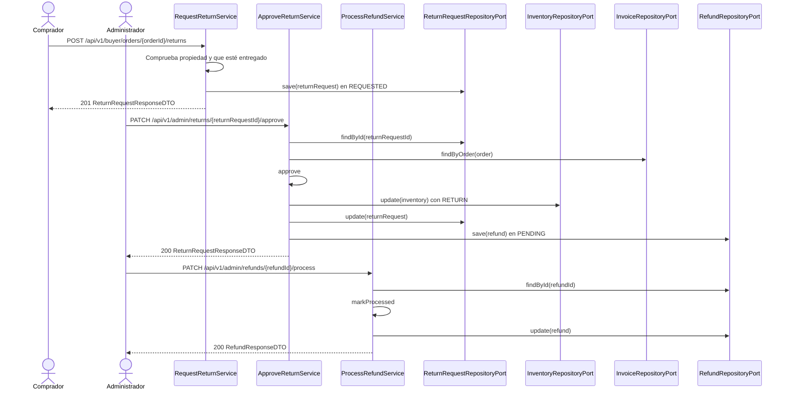
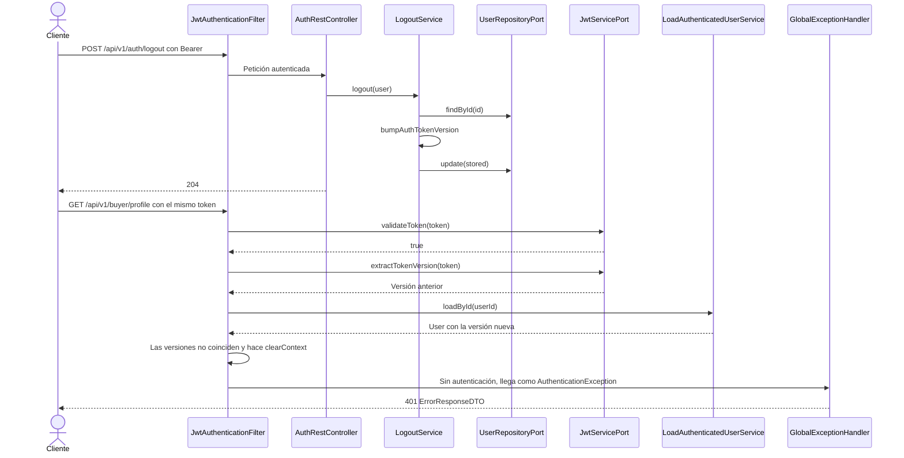

# Flujos por endpoint

La matriz se genera desde los controladores y los casos de uso, y se compara con [Api-rest-endpoints.md](../Adapters/Api-rest-endpoints.md). Los diagramas de secuencia muestran el camino feliz; los errores están en la tabla final.

## 1. Matriz de los 108 endpoints

<!-- MATRIZ-INICIO: la genera tools/gen_c4_matrix.py -->

### Autenticación — `AuthRestController`, `PublicAccessPort`

| Método | Ruta | Método del puerto | Servicio | OK |
| --- | --- | --- | --- | ---: |
| `POST` | `/api/v1/auth/login` | `login` | `LoginService` | 200 |
| `POST` | `/api/v1/auth/logout` | `logout` | `LogoutService` | 204 |
| `POST` | `/api/v1/auth/register/buyers` | `registerBuyerUser` | `RegisterBuyerUserService` | 201 |

### Público — `PublicRestController`, `PublicAccessPort`

| Método | Ruta | Método del puerto | Servicio | OK |
| --- | --- | --- | --- | ---: |
| `GET` | `/api/v1/public/products` | `consultCatalog` | `ConsultCatalogService` | 200 |
| `GET` | `/api/v1/public/products/{productId}` | `consultCatalogProduct` | `ConsultCatalogService` | 200 |

### Comprador — `BuyerRestController`, `BuyerPort`

| Método | Ruta | Método del puerto | Servicio | OK |
| --- | --- | --- | --- | ---: |
| `GET` | `/api/v1/buyer/account` | `consultUser` | `ConsultUserService` | 200 |
| `PUT` | `/api/v1/buyer/account/password` | `changeUserPassword` | `ChangeUserPasswordService` | 204 |
| `GET` | `/api/v1/buyer/profile` | `consultBuyer` | `ConsultBuyerService` | 200 |
| `PUT` | `/api/v1/buyer/profile` | `updateBuyerProfile` | `UpdateBuyerProfileService` | 200 |
| `GET` | `/api/v1/buyer/cart` | `consultCart` | `ConsultCartService` | 200 |
| `POST` | `/api/v1/buyer/cart/items` | `addItemToCart` | `AddItemToCartService` | 200 |
| `PATCH` | `/api/v1/buyer/cart/items/{productId}` | `updateCartItemQuantity` | `UpdateCartItemQuantityService` | 200 |
| `DELETE` | `/api/v1/buyer/cart/items/{productId}` | `removeItemFromCart` | `RemoveItemFromCartService` | 200 |
| `DELETE` | `/api/v1/buyer/cart/items` | `clearCart` | `ClearCartService` | 200 |
| `POST` | `/api/v1/buyer/orders` | `confirmOrder` | `ConfirmOrderService` | 201 |
| `POST` | `/api/v1/buyer/orders/{orderId}/payment` | `validatePayment` | `ValidatePaymentService` | 200 |
| `GET` | `/api/v1/buyer/orders` | `consultBuyerOrders` | `ConsultBuyerOrdersService` | 200 |
| `GET` | `/api/v1/buyer/orders/{orderId}` | `consultOrder` | `ConsultOrderService` | 200 |
| `GET` | `/api/v1/buyer/orders/{orderId}/invoice` | `consultInvoice` | `ConsultInvoiceService` | 200 |
| `POST` | `/api/v1/buyer/orders/{orderId}/returns` | `requestReturn` | `RequestReturnService` | 201 |
| `GET` | `/api/v1/buyer/returns/{returnRequestId}` | `consultReturn` | `ConsultReturnService` | 200 |
| `GET` | `/api/v1/buyer/returns/{returnRequestId}/refund` | `consultRefund` | `ConsultReturnService` | 200 |

### Vendedor — `SellerRestController`, `SellerPort`

| Método | Ruta | Método del puerto | Servicio | OK |
| --- | --- | --- | --- | ---: |
| `GET` | `/api/v1/seller/account` | `consultUser` | `ConsultUserService` | 200 |
| `PUT` | `/api/v1/seller/account/password` | `changeUserPassword` | `ChangeUserPasswordService` | 204 |
| `GET` | `/api/v1/seller/profile` | `consultSeller` | `ConsultSellerService` | 200 |
| `PATCH` | `/api/v1/seller/profile` | `updateSeller` | `UpdateSellerService` | 200 |
| `POST` | `/api/v1/seller/warehouses` | `registerWarehouse` | `RegisterWarehouseService` | 201 |
| `GET` | `/api/v1/seller/warehouses` | `consultWarehouses` | `ConsultWarehouseService` | 200 |
| `GET` | `/api/v1/seller/warehouses/{warehouseId}` | `consultWarehouse` | `ConsultWarehouseService` | 200 |
| `PUT` | `/api/v1/seller/warehouses/{warehouseId}` | `updateWarehouse` | `UpdateWarehouseService` | 200 |
| `POST` | `/api/v1/seller/products` | `registerProduct` | `RegisterProductService` | 201 |
| `GET` | `/api/v1/seller/products` | `consultSellerProducts` | `ConsultSellerProductsService` | 200 |
| `PUT` | `/api/v1/seller/products/{productId}` | `updateProduct` | `UpdateProductService` | 200 |
| `PATCH` | `/api/v1/seller/products/{productId}/publish` | `publishProduct` | `PublishProductService` | 200 |
| `PATCH` | `/api/v1/seller/products/{productId}/suspend` | `suspendProduct` | `SuspendProductService` | 200 |
| `PATCH` | `/api/v1/seller/products/{productId}/discontinue` | `discontinueProduct` | `DiscontinueProductService` | 200 |
| `POST` | `/api/v1/seller/inventories` | `registerInitialStock` | `RegisterInitialStockService` | 201 |
| `POST` | `/api/v1/seller/inventories/{productId}/{warehouseId}/inbounds` | `registerInventoryInbound` | `RegisterInventoryInboundService` | 201 |
| `GET` | `/api/v1/seller/products/{productId}/inventories` | `consultProductInventory` | `ConsultInventoryService` | 200 |
| `GET` | `/api/v1/seller/warehouses/{warehouseId}/inventories` | `consultWarehouseInventory` | `ConsultInventoryService` | 200 |
| `GET` | `/api/v1/seller/orders/{orderId}` | `consultOrder` | `ConsultOrderService` | 200 |
| `GET` | `/api/v1/seller/reports/performance` | `consultSellerPerformanceReport` | `ConsultSellerPerformanceReportService` | 200 |

### Operador logístico — `LogisticsOperatorRestController`, `LogisticsOperatorPort`

| Método | Ruta | Método del puerto | Servicio | OK |
| --- | --- | --- | --- | ---: |
| `GET` | `/api/v1/logistics/account` | `consultUser` | `ConsultUserService` | 200 |
| `PUT` | `/api/v1/logistics/account/password` | `changeUserPassword` | `ChangeUserPasswordService` | 204 |
| `GET` | `/api/v1/logistics/warehouses` | `consultWarehouses` | `ConsultWarehouseService` | 200 |
| `GET` | `/api/v1/logistics/warehouses/{warehouseId}` | `consultWarehouse` | `ConsultWarehouseService` | 200 |
| `POST` | `/api/v1/logistics/inventories` | `registerInitialStock` | `RegisterInitialStockService` | 201 |
| `POST` | `/api/v1/logistics/inventories/{productId}/{warehouseId}/inbounds` | `registerInventoryInbound` | `RegisterInventoryInboundService` | 201 |
| `POST` | `/api/v1/logistics/inventories/{productId}/{warehouseId}/adjustments` | `registerInventoryAdjustment` | `RegisterInventoryAdjustmentService` | 201 |
| `POST` | `/api/v1/logistics/inventories/{productId}/{warehouseId}/reservations` | `reserveInventory` | `ReserveInventoryService` | 201 |
| `POST` | `/api/v1/logistics/inventories/{productId}/{warehouseId}/reservation-releases` | `releaseInventoryReservation` | `ReleaseInventoryReservationService` | 201 |
| `GET` | `/api/v1/logistics/products/{productId}/inventories` | `consultProductInventory` | `ConsultInventoryService` | 200 |
| `GET` | `/api/v1/logistics/warehouses/{warehouseId}/inventories` | `consultWarehouseInventory` | `ConsultInventoryService` | 200 |
| `GET` | `/api/v1/logistics/orders/{orderId}` | `consultOrder` | `ConsultOrderService` | 200 |
| `POST` | `/api/v1/logistics/orders/{orderId}/shipments` | `createShipments` | `CreateShipmentsService` | 201 |
| `PATCH` | `/api/v1/logistics/shipments/{shipmentId}/pack` | `packShipment` | `PackShipmentService` | 200 |
| `PATCH` | `/api/v1/logistics/shipments/{shipmentId}/dispatch` | `dispatchShipment` | `DispatchShipmentService` | 200 |
| `PATCH` | `/api/v1/logistics/shipments/{shipmentId}/deliver` | `confirmDelivery` | `ConfirmDeliveryService` | 200 |
| `GET` | `/api/v1/logistics/reports/inventory` | `consultInventoryReport` | `ConsultInventoryReportService` | 200 |

### Administrador — `AdministratorRestController`, `AdministratorPort`

| Método | Ruta | Método del puerto | Servicio | OK |
| --- | --- | --- | --- | ---: |
| `PUT` | `/api/v1/admin/account/password` | `changeUserPassword` | `ChangeUserPasswordService` | 204 |
| `POST` | `/api/v1/admin/staff-users` | `registerStaffUser` | `RegisterStaffUserService` | 201 |
| `GET` | `/api/v1/admin/users/{userId}` | `consultUser` | `ConsultUserService` | 200 |
| `PATCH` | `/api/v1/admin/users/{userId}/status` | `changeUserStatus` | `ChangeUserStatusService` | 200 |
| `POST` | `/api/v1/admin/sellers` | `registerSeller` | `RegisterSellerService` | 201 |
| `GET` | `/api/v1/admin/sellers/{sellerId}` | `consultSeller` | `ConsultSellerService` | 200 |
| `PATCH` | `/api/v1/admin/sellers/{sellerId}` | `updateSeller` | `UpdateSellerService` | 200 |
| `GET` | `/api/v1/admin/sellers/{sellerId}/products` | `consultSellerProducts` | `ConsultSellerProductsService` | 200 |
| `GET` | `/api/v1/admin/buyers/{buyerId}` | `consultBuyer` | `ConsultBuyerService` | 200 |
| `PATCH` | `/api/v1/admin/buyers/{buyerId}/commercial-status` | `changeBuyerCommercialStatus` | `ChangeBuyerCommercialStatusService` | 200 |
| `POST` | `/api/v1/admin/warehouses` | `registerWarehouse` | `RegisterWarehouseService` | 201 |
| `GET` | `/api/v1/admin/warehouses` | `consultWarehouses` | `ConsultWarehouseService` | 200 |
| `GET` | `/api/v1/admin/warehouses/{warehouseId}` | `consultWarehouse` | `ConsultWarehouseService` | 200 |
| `PUT` | `/api/v1/admin/warehouses/{warehouseId}` | `updateWarehouse` | `UpdateWarehouseService` | 200 |
| `GET` | `/api/v1/admin/orders/{orderId}/invoice` | `consultInvoice` | `ConsultInvoiceService` | 200 |
| `GET` | `/api/v1/admin/returns/{returnRequestId}` | `consultReturn` | `ConsultReturnService` | 200 |
| `PATCH` | `/api/v1/admin/returns/{returnRequestId}/approve` | `approveReturn` | `ApproveReturnService` | 200 |
| `PATCH` | `/api/v1/admin/returns/{returnRequestId}/reject` | `rejectReturn` | `RejectReturnService` | 200 |
| `GET` | `/api/v1/admin/returns/{returnRequestId}/refund` | `consultRefund` | `ConsultReturnService` | 200 |
| `PATCH` | `/api/v1/admin/refunds/{refundId}/process` | `processRefund` | `ProcessRefundService` | 200 |
| `GET` | `/api/v1/admin/audit-logs` | `consultAuditLogs` | `ConsultAuditLogsService` | 200 |
| `GET` | `/api/v1/admin/audit-logs/users/{userId}` | `consultAuditLogsByUser` | `ConsultAuditLogsService` | 200 |
| `GET` | `/api/v1/admin/audit-logs/entities/{entityType}/{entityId}` | `consultAuditLogsByEntity` | `ConsultAuditLogsService` | 200 |
| `GET` | `/api/v1/admin/reports/commercial` | `consultCommercialReport` | `ConsultCommercialReportService` | 200 |
| `GET` | `/api/v1/admin/reports/sellers/{sellerId}/performance` | `consultSellerPerformanceReport` | `ConsultSellerPerformanceReportService` | 200 |
| `GET` | `/api/v1/admin/reports/inventory` | `consultInventoryReport` | `ConsultInventoryReportService` | 200 |
| `GET` | `/api/v1/admin/reports/logistics` | `consultLogisticsReport` | `ConsultLogisticsReportService` | 200 |

### Supervisor — `SupervisorRestController`, `SupervisorPort`

| Método | Ruta | Método del puerto | Servicio | OK |
| --- | --- | --- | --- | ---: |
| `PUT` | `/api/v1/supervisor/account/password` | `changeUserPassword` | `ChangeUserPasswordService` | 204 |
| `GET` | `/api/v1/supervisor/users/{userId}` | `consultUser` | `ConsultUserService` | 200 |
| `GET` | `/api/v1/supervisor/sellers/{sellerId}` | `consultSeller` | `ConsultSellerService` | 200 |
| `GET` | `/api/v1/supervisor/buyers/{buyerId}` | `consultBuyer` | `ConsultBuyerService` | 200 |
| `GET` | `/api/v1/supervisor/warehouses` | `consultWarehouses` | `ConsultWarehouseService` | 200 |
| `GET` | `/api/v1/supervisor/warehouses/{warehouseId}` | `consultWarehouse` | `ConsultWarehouseService` | 200 |
| `GET` | `/api/v1/supervisor/sellers/{sellerId}/products` | `consultSellerProducts` | `ConsultSellerProductsService` | 200 |
| `GET` | `/api/v1/supervisor/products/{productId}/inventories` | `consultProductInventory` | `ConsultInventoryService` | 200 |
| `GET` | `/api/v1/supervisor/warehouses/{warehouseId}/inventories` | `consultWarehouseInventory` | `ConsultInventoryService` | 200 |
| `GET` | `/api/v1/supervisor/buyers/{buyerId}/cart` | `consultCart` | `ConsultCartService` | 200 |
| `GET` | `/api/v1/supervisor/buyers/{buyerId}/orders` | `consultBuyerOrders` | `ConsultBuyerOrdersService` | 200 |
| `GET` | `/api/v1/supervisor/orders/{orderId}` | `consultOrder` | `ConsultOrderService` | 200 |
| `GET` | `/api/v1/supervisor/orders/{orderId}/invoice` | `consultInvoice` | `ConsultInvoiceService` | 200 |
| `GET` | `/api/v1/supervisor/returns/{returnRequestId}` | `consultReturn` | `ConsultReturnService` | 200 |
| `GET` | `/api/v1/supervisor/returns/{returnRequestId}/refund` | `consultRefund` | `ConsultReturnService` | 200 |
| `GET` | `/api/v1/supervisor/audit-logs` | `consultAuditLogs` | `ConsultAuditLogsService` | 200 |
| `GET` | `/api/v1/supervisor/audit-logs/users/{userId}` | `consultAuditLogsByUser` | `ConsultAuditLogsService` | 200 |
| `GET` | `/api/v1/supervisor/audit-logs/entities/{entityType}/{entityId}` | `consultAuditLogsByEntity` | `ConsultAuditLogsService` | 200 |
| `GET` | `/api/v1/supervisor/reports/commercial` | `consultCommercialReport` | `ConsultCommercialReportService` | 200 |
| `GET` | `/api/v1/supervisor/reports/sellers/{sellerId}/performance` | `consultSellerPerformanceReport` | `ConsultSellerPerformanceReportService` | 200 |
| `GET` | `/api/v1/supervisor/reports/inventory` | `consultInventoryReport` | `ConsultInventoryReportService` | 200 |
| `GET` | `/api/v1/supervisor/reports/logistics` | `consultLogisticsReport` | `ConsultLogisticsReportService` | 200 |

<!-- MATRIZ-FIN -->

## 2. Login

Normaliza el correo, compara la contraseña y emite el token. La misma respuesta `401` cubre el correo inexistente y la contraseña incorrecta, para no revelar qué correos están registrados.

## 3. Confirmar pedido

Convierte el carrito en un pedido `PENDING_PAYMENT`, reserva el stock de los productos físicos y vacía el carrito, todo en la misma transacción.

## 4. Pagar

Un pago aprobado genera la factura. Si el pedido solo tiene productos digitales, queda entregado de inmediato. Un pago rechazado queda en la auditoría, gracias a `noRollbackFor`, y responde 422.

## 5. Despachar

Solo el operador asignado puede despachar el envío. Las reservas se convierten en salidas de inventario, y el pedido pasa a `SHIPPED`.

## 6. Devolución

Tiene tres pasos: el comprador la solicita sobre un pedido entregado, el administrador la aprueba, con lo que el stock vuelve y se crea el reembolso, y por último procesa ese reembolso.

El reembolso es por el total de la factura. El administrador obtiene su id con `GET /api/v1/admin/returns/{returnRequestId}/refund`.

## 7. Logout e invalidación del token

El logout cambia `authTokenVersion`. El token sigue teniendo una firma válida y no ha vencido, pero su `ver` ya no coincide, así que la siguiente petición responde 401.

Cambiar la contraseña o el estado del usuario invalida los tokens del mismo modo.

## 8. Compra de principio a fin

La carpeta "Flujo completo" de la colección de Postman recorre estos flujos en orden, con el inventario de cada etapa. Ver [SETUP.md](../../SETUP.md).

## 9. Errores

| Código | Cuándo | Ejemplo |
| --- | --- | --- |
| 400 | Validación, JSON o parámetro inválido, regla de datos | Carrito vacío al confirmar, fecha mal formada |
| 401 | Sin token, token inválido o vencido, versión desactualizada, usuario no activo, credenciales incorrectas | Token tras el logout |
| 403 | Rol no permitido o recurso de otro usuario | Comprador en una ruta de administrador, login de un usuario bloqueado |
| 404 | Entidad o ruta inexistente | Pedido desconocido |
| 405, 415 | Método o tipo de contenido no admitido | `PUT` sobre el catálogo |
| 409 | Duplicado, transición inválida, stock insuficiente o bloqueo optimista | Vendedor duplicado, empacar un envío ya entregado |
| 422 | Pago rechazado | Total por encima del límite de aprobación |
| 500 | Error inesperado, sin detalles internos | — |

La tabla completa está en [Global-exception-handler.md](../Adapters/Global-exception-handler.md).
